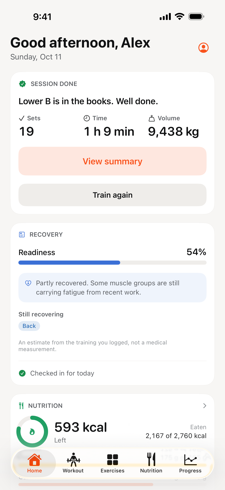
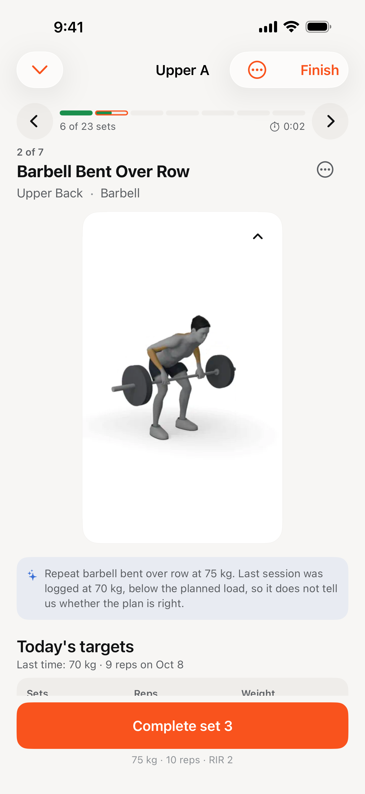
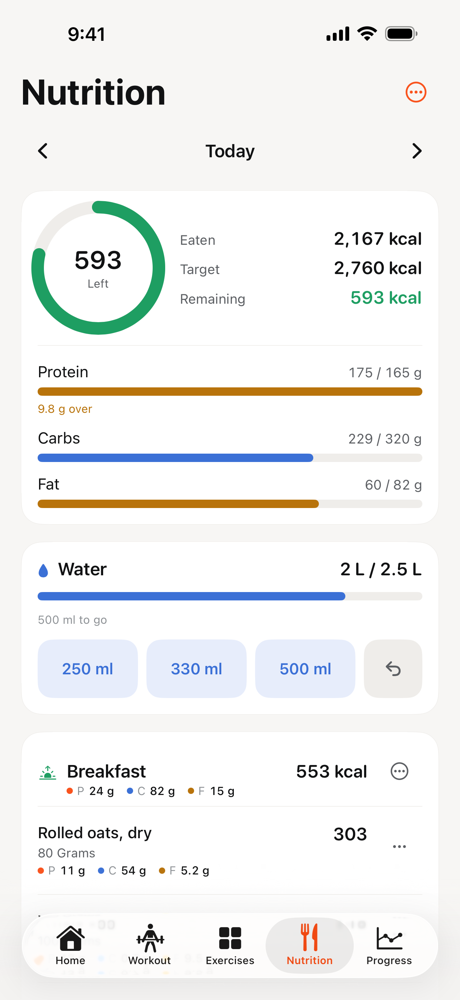
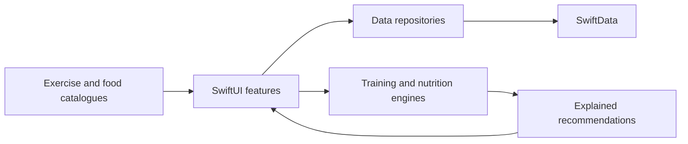

# Forge

### Adaptive training. Nutrition in the same place.

An iPhone and iPad app that builds a training plan around your goals, equipment and schedule, then adjusts it as you log your workouts. Forge pairs that plan with exercise demonstrations, nutrition tracking and progress insights, with the core experience running on device.

**Swift · SwiftUI · SwiftData · Swift Charts · iOS 18+**

[Run in Simulator](#run-in-simulator) · [Explore the screens](#a-look-inside) · [Engineering guide](docs/ENGINEERING.md)

## A look inside

<table>
<tr>
<td width="33%"></td>
<td width="33%"></td>
<td width="33%"></td>
</tr>
<tr><td align="center">Your day</td><td align="center">Your training</td><td align="center">Your nutrition</td></tr>
</table>

*Actual Simulator captures from the repository's English screenshot set.*

## What Forge does

- **Plans around you:** uses your goals, experience, equipment and available days to build a program.
- **Adapts to your sessions:** progression, autoregulation and deload engines use logged performance to shape recommendations, with an explanation for each adjustment.
- **Shows the movement:** 500 exercises with original 3D demonstrations and instructions in ten languages.
- **Finds a substitute:** ranks alternatives when equipment is unavailable or an exercise needs to change.
- **Keeps nutrition close:** calorie and macro targets, food logging, saved meals, recipes and weight trends.
- **Lets you stay in control:** override recommendations, lock exercises or build a program manually.

No account is required. Core planning and tracking run locally; optional features include HealthKit integration, notifications, widgets, Live Activities and remote food lookup.

## Run in Simulator

Requires **macOS**, **Xcode 26+** and an installed iOS Simulator runtime. The app targets **iOS 18.0+**. There are no third-party Swift package dependencies to configure.

```bash
git clone https://github.com/Ale-Newport/Gym-App.git
cd Gym-App
open GymApp.xcodeproj
```

1. Select the **GymApp** scheme.
2. Select an installed **iPhone Simulator** as the destination.
3. Press **Run** (`Cmd+R`) and complete onboarding to generate a plan.

The Xcode project is already committed, so XcodeGen is unnecessary for this first run. A Simulator build does not require your own Apple Developer team. For a physical device, configure your signing team, bundle identifiers and App Group as described in the [engineering guide](docs/ENGINEERING.md).

### Command-line build

Choose a destination available on your Mac (`xcrun simctl list devices available`):

```bash
xcodebuild -project GymApp.xcodeproj -scheme GymApp \
  -destination 'platform=iOS Simulator,name=iPhone 17 Pro' \
  -configuration Debug build
```

If you add or remove source files later, regenerate the project from `project.yml` with **XcodeGen** before building:

```bash
brew install xcodegen
xcodegen generate
```

## How it is built

The domain engines accept value types and return decisions. Repositories own persistence, and SwiftUI views consume the results. This keeps training and nutrition rules testable without rendering the interface.



| Directory | Responsibility |
| --- | --- |
| `GymApp/Features/` | Onboarding, workouts, exercises, nutrition and progress |
| `GymApp/Domain/` | Training, nutrition and analytics logic |
| `GymApp/Data/` | Repositories and reference catalogues |
| `GymApp/Core/` | Persistence, design system and platform integrations |
| `GymApp/Resources/` | Exercise media, translations and bundled food data |
| `GymAppWidgets/` | Widgets and Live Activity |
| `GymAppTests/` + `GymAppUITests/` | Unit and interface tests |

## Tests and screenshots

```bash
xcodebuild test -project GymApp.xcodeproj -scheme GymApp \
  -destination 'platform=iOS Simulator,name=iPhone 17 Pro'

# Regenerate the English App Store screenshot set.
Tools/screenshots.sh en
```

The screenshot script requires the device names listed in `Tools/screenshots.sh`. More languages and device captures are available in [Screenshots/](Screenshots/). These existing captures were reviewed for this README; a fresh Simulator test run was not performed for this documentation update.

## Further reading

The [engineering guide](docs/ENGINEERING.md) covers the algorithms, datasets, localisation, architecture and release workflow. Also see [privacy](docs/PRIVACY.md), [licences and attribution](docs/LICENSES.md) and the [algorithm reference](docs/ALGORITHMS.md).
